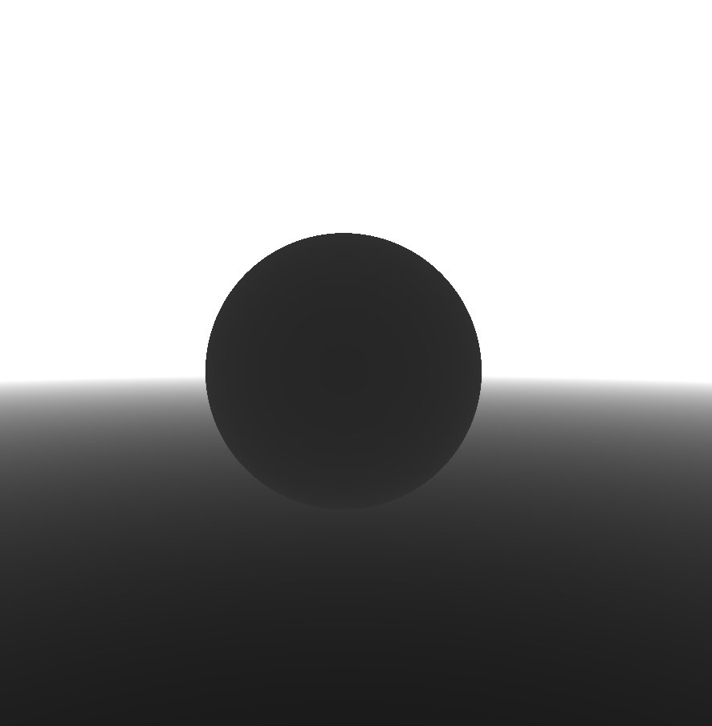
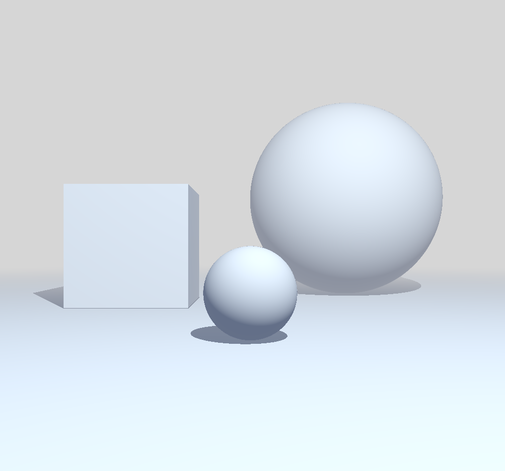

name: inverse
layout: true
class: center, middle, inverse
---


# Shader Programming Workshop

#### Prof. Dr. Lena Gieseke | l.gieseke@filmuniversitaet.de  
#### Film University Babelsberg KONRAD WOLF

<br >

## *Overview 3*


<!--
Start server in /doc/

h or ?: Toggle the help window
j: Jump to next slide
k: Jump to previous slide
b: Toggle blackout mode
m: Toggle mirrored mode.
c: Create a clone presentation on a new window
p: Toggle PresenterMode
f: Toggle Fullscreen
t: Reset presentation timer
<number> + <Return>: Jump to slide <number>
-->

---
layout:false

## The Workshop


Technology


* Shader pipeline ✓
* Example three.js ✓
* Fragment shader 

Scenario

* Rendering a 3D scene in in a fragment shader 


---
layout: false

## The Workshop

Rendering a 3D scene in in a fragment shader 

* Implicit Geometry ✓
* Signed Distance Functions ✓
* 3D Scene Rendering ✓
* Sphere Tracing ✓
* Simple Shading
* Implementation 
  


--
* Transformations

--
* Constructive Solid Geometry

--
* Further Effects

---
## Re-Cap

.center[]

---
## Preview

.center[<video autoplay loop width="500"><source src="./img/preview_02.webm"type="video/webm"></video>]

???
  


.center[]

---
## Preview

.center[<video autoplay loop width="500"><source src="img/preview_04.webm"type="video/webm"></video>]


???
  

* Show three.js example

.center[<video autoplay loop width="500"><source src="img/preview_05.webm"type="video/webm"></video>]

---
layout: false

## Last Time...

* Signed Distance Functions

???
  

* What was the general idea?
* SDF: An implicit equation returns the (squared) distance of any point in three-dimensional space to the surface of the object.
* Analytically defined geometry, meaning a **function** or equations define the geometry.

* We can mathematically combine and manipulate implicit surfaces in all sort of ways to create shapes.
* The most basic assembly methods are with *boolean operators*

--
* Sphere Tracing

???
  

* What was the general idea?
* Rendering -> Shoot a ray through each fragment into the scene. Detect the surface a ray hits and use the surface color for the fragment.
* Sphere Tracing
    * We shoot from a point of view ("camera") a ray through the fragment into the scene
    * We go step by step along the view ray in order to find the surface it hits
        * For taking a step along the ray, we compute the distances to all objects in the scene
        * From those distances we take the smallest one as step size
        * We decide on an intersection once the step size is below a threshold
    * (We take the color of the hit surface point as fragment color - we will come back to this)
* This algorithm is called *sphere tracing* because when you compute the smallest distance from a point to all surfaces, this distance can be seen as the radius of a sphere within which we can move freely without ever intersecting with a surface. 

--
    * It is usually just called ***ray marching***
--
    * In different flavors in almost all fragement shaders with a 3D look
--
    * Computing the minimal distance to all surfaces in a scene is often called `map()` (in our examples this is `sdfScene()`)
--
* Computation of the normal of a surface point with gradients

???

* Diffuse Reflection
* Ambient Light
* Shadowing


* We need to decrease in the intensity of the light by a factor of ${cosθ}$
* The value of ${cosθ}$ is given by the **dot product** between the normal vector $N$ and the unit direction to the light source $L$. 
* We clamp the dot product to zero in our illumination calculations. 


* For simple shading we usually add a constant color to mimic ambient light.


Shadows  
* Compute the distance from the point to the light
* Compute the distance from the point to the scene surfaces along the point-light-ray
* If the distance to the scene is smaller than the distance to the light then there is an object between surface point and light, and we need to add shadow to the shading of the point.

---
## Sphere Tracing

--

```glsl
void main() {

    ...

    vec3 ray_origin = vec3(0, 0.1, -2);

    vec3 ray_direction = normalize(vec3(p, 1));

    float distance_to_scene = sphereTracing(ray_origin, ray_direction);

    ...
}
```

---
## Sphere Tracing


```glsl
void main() {

    ...

    // The Camera
    // Camera position
    vec3 ray_origin = vec3(0, 0.1, -2);

    // Camera direction
    // Shooting a ray "through" the current fragment
    vec3 ray_direction = normalize(vec3(p, 1));

    float distance_to_scene = sphereTracing(ray_origin, ray_direction);

    ...
}
```

---
## Sphere Tracing

```glsl
float sphereTracing(vec3 ray_origin, vec3 ray_direction) {
    float distance_traveled = 0.;

    for(int i=0; i < STEPS_MAX; i++) {
        vec3 point_on_ray = ray_origin + ray_direction * distance_traveled;

        float distance_to_scene = sdfScene(point_on_ray);

        if(distance_to_scene < DISTANCE_MIN) break;

        distance_traveled += distance_to_scene;

        if(distance_traveled > DISTANCE_MAX) break;
    }

    return distance_traveled;
}
```

---
## Sphere Tracing

```glsl
float sphereTracing(vec3 ray_origin, vec3 ray_direction) {
    
    float distance_traveled = 0.; // How far we have moved along the ray so far?
    for(int i=0; i < STEPS_MAX; i++) {
        // The current point on the ray
        vec3 point_on_ray = ray_origin + ray_direction * distance_traveled;

        // Compute the minimal distance from the current point to all surfaces in 
        // the scene (the radius of the sphere in which we can move freely)
        float distance_to_scene = sdfScene(point_on_ray);

        // Is the step size below the threshold? Then we have a hit with the scene.
        if(distance_to_scene < DISTANCE_MIN) break;

        // Move along the ray by that distance
        distance_traveled += distance_to_scene;

        if(distance_traveled > DISTANCE_MAX) break; // Did we overshoot?
    }
    return distance_traveled;
}
```


---
template:inverse

## Hands On!
# 🧑🏻‍💻

---
## Exercise

1. We follow the steps in script [spheretracing_steps.md](../02_code/glsl/spheretracing/spheretracing_steps.md) to implement the scene.


???

# Implementing Diffuse Shading

## Diffuse Shading

* Start with file `spheretracing_step_00_start.frag`
* The code to be added can be found in `spheretracing_steps.md`


???
  


## Diffuse Shading

```glsl
void main() {
    ...

    vec3 point_on_surface = ray_origin + ray_direction * distance_to_scene;

    color = getDiffuseShading(point_on_surface);

    gl_FragColor = vec4(color, 1.0);
}
```


```glsl
vec3 getDiffuseShading(vec3 point_on_surface) {
    ...

    return vec3((color_material * reflection_diffuse * shading_shadow) + color_ambient);
}
```


## Lights

```glsl
vec3 getDiffuseShading(vec3 point_on_surface) {
    // The Light
    // Light position
    vec3 light_position = vec3(2, 8, 0);
    light_position.xz += vec2(sin(u_time), cos(u_time)) * 6.;

    // Light direction
    vec3 direction_to_light = normalize(light_position - point_on_surface);

    ...

```


## Normals

```glsl
    // Normal of the surface
    vec3 surface_normal = estimateNormal(point_on_surface);
```


## Normals

```glsl
vec3 estimateNormal(vec3 p) { // p is point_on_surface
    vec3 n = vec3(
        sdfScene(vec3(p.x + EPSILON, p.y, p.z)) - sdfScene(vec3(p.x - EPSILON, p.y, p.z)),
        sdfScene(vec3(p.x, p.y + EPSILON, p.z)) - sdfScene(vec3(p.x, p.y - EPSILON, p.z)),
        sdfScene(vec3(p.x, p.y, p.z  + EPSILON)) - sdfScene(vec3(p.x, p.y, p.z - EPSILON))
    );

    // The same as above but more
    // elegantly with swizzling
    // const vec2 h = vec2(EPSILON,0);
    // vec3 n = vec3(sdfScene(p+h.xyy) - sdfScene(p-h.xyy),
    //               sdfScene(p+h.yxy) - sdfScene(p-h.yxy),
    //               sdfScene(p+h.yyx) - sdfScene(p-h.yyx));

    return normalize(n);
}
```


## Normals

```glsl
vec3 estimateNormal(vec3 p) { // p is point_on_surface
    //vec3 n = vec3(
    //    sdfScene(vec3(p.x + EPSILON, p.y, p.z)) - sdfScene(vec3(p.x - EPSILON, p.y, p.z)),
    //    sdfScene(vec3(p.x, p.y + EPSILON, p.z)) - sdfScene(vec3(p.x, p.y - EPSILON, p.z)),
    //    sdfScene(vec3(p.x, p.y, p.z  + EPSILON)) - sdfScene(vec3(p.x, p.y, p.z - EPSILON))
    //);

    // The same as above but more
    // elegantly with swizzling
    const vec2 h = vec2(EPSILON,0);
    vec3 n = vec3(sdfScene(p+h.xyy) - sdfScene(p-h.xyy),
                  sdfScene(p+h.yxy) - sdfScene(p-h.yxy),
                  sdfScene(p+h.yyx) - sdfScene(p-h.yyx));

    return normalize(n);
}
```


## Material and Reflection

```glsl
    vec3 color_material = vec3(0.8, 0.8, 0.8);
    float reflection_diffuse = max(dot(surface_normal, direction_to_light), 0.);

    vec3 color_ambient = vec3(0.06, 0.1, 0.2);
```


## Material and Reflection

```glsl
    // The reflection behavior
    vec3 color_material = vec3(0.8, 0.8, 0.8);
    float reflection_diffuse = max(dot(surface_normal, direction_to_light), 0.);

    // Ambient Light
    // To lighten up everything a bit
    vec3 color_ambient = vec3(0.06, 0.1, 0.2);
```


## Shadow

```glsl
#define MOVE_POINT .02

...

    vec3 point_moved_up = vec3 (point_on_surface + surface_normal * MOVE_POINT);

    float distance_to_scene_light_direction =
                        sphereTracing(point_moved_up, direction_to_light);

    float shading_shadow = 1.;
    if(distance_to_scene_light_direction < length(light_position-point_on_surface)) {
        shading_shadow *= .1;
    }
```


## Shadow

```glsl
#define MOVE_POINT .02

...

    // The shadow
    // We need to make sure that we are not stuck inside of the shape
    // For that we move the point a tiny bit along the direction
    // of the surface normal (MOVE_POINT must be larger than
    // DISTANCE_MIN, otherwise we immediately hit the surface again)
    vec3 point_moved_up = vec3 (point_on_surface + surface_normal * MOVE_POINT);

    float distance_to_scene_light_direction =
                        sphereTracing(point_moved_up, direction_to_light);

    // If the distance to the scene is smaller than the distance to the light
    // then there is an object between surface point and light, and
    // with that the surface point is in the shadow
    float shading_shadow = 1.;
    if(distance_to_scene_light_direction < length(light_position-point_on_surface)) {
        // This factor reduces the light
        shading_shadow *= .1;
    }
```


```glsl
vec3 getDiffuseShading(vec3 point_on_surface) {
    ...

    return vec3((color_material * reflection_diffuse * shading_shadow) + color_ambient);
}
```


* https://www.shadertoy.com/view/Xds3zN
    * https://iquilezles.org/articles/rmshadows/
* https://www.shadertoy.com/view/ltyXD3 (commented)
* https://www.shadertoy.com/view/WsSBzh


/Users/legie/Documents/filmuni/03_teaching/class/shader_programming/workshop_shader_programming/docs/code/spheretracing_07_diffuse_shading.frag

---
template: inverse

#### The End

# 🤓


