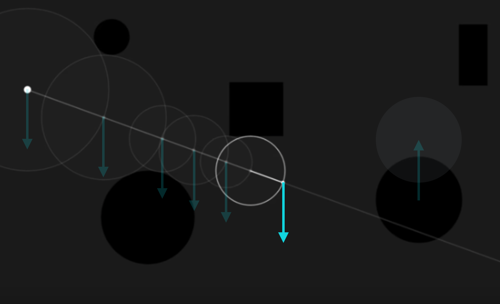
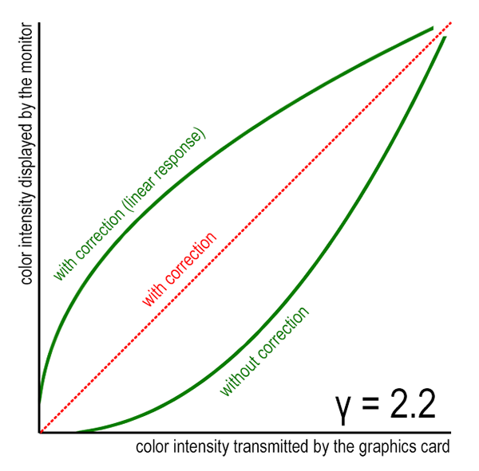
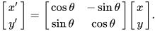

# Building a Repetition Scene Step by Step

In this tutorial, we turn one sphere into an infinite field of spheres that we fly through. All of this takes only a few lines of code, because we don't add any objects. We only change how we look at the one sphere we already have. We continue with the shader from the [sphere tracing tutorial](../spheretracing/spheretracing_steps.md) and add one concept at a time. After every step, you should have a working shader.

The steps follow the slides on [scene building](../../../01_slides/shader_08_scenebuilding_slides.html).

For each step there is a code file with the result of that step. If you get lost, compare your code with it or simply continue from there.

| Step                  | Result                                                                                           |
| --------------------- | ------------------------------------------------------------------------------------------------ |
| Start                 | [scenesetup_repetition_step_00_start.frag](./scenesetup_repetition_step_00_start.frag)           |
| 1. Repetition         | [scenesetup_repetition_step_01_repetition.frag](./solution/scenesetup_repetition_step_01_repetition.frag) |
| 2. Fog                | [scenesetup_repetition_step_02_fog.frag](./solution/scenesetup_repetition_step_02_fog.frag)               |
| 3. Gamma Correction   | [scenesetup_repetition_step_03_gamma.frag](./solution/scenesetup_repetition_step_03_gamma.frag)           |
| 4. Animate the Camera | [scenesetup_repetition_step_04_camera.frag](./solution/scenesetup_repetition_step_04_camera.frag)         |
| 5. Random Offset      | [scenesetup_repetition_step_05_offset.frag](./solution/scenesetup_repetition_step_05_offset.frag)         |


* [The Start File](#the-start-file)
* [1. Repetition](#1-repetition)
    * [The Idea](#the-idea)
    * [The Code](#the-code)
    * [Adjusting the Light](#adjusting-the-light)
* [2. Fog](#2-fog)
* [3. Gamma Correction](#3-gamma-correction)
* [4. Animate the Camera](#4-animate-the-camera)
    * [Moving the Camera](#moving-the-camera)
    * [Rotating the View](#rotating-the-view)
* [5. Random Offset](#5-random-offset)
* [Summary](#summary)
* [References](#references)


## The Start File

The start file is the final result of the sphere tracing tutorial: a shaded sphere on a plane, with a moving light and a shadow. If you still have your own version, you can simply continue with it.

The file still contains the markers from the sphere tracing tutorial, like `// ---- [C] The Scene ----`. Every **▶ TODO** below is numbered by its step (1.1, 1.2, ...) and names the marker, which hopefully helps you to find the right place for the new code. We only need these markers:

| Marker                   | What changes there                      |
| ------------------------ | --------------------------------------- |
| `[A]` Uniforms & Defines | New constants                           |
| `[C]` The Scene          | The repetition and the random offset    |
| `[F]` Shading            | The light setup                         |
| `[G]` The Camera         | *In `main()`:* the camera animation     |
| `[I]` The Fragment Color | *In `main()`:* fog and gamma correction |


## 1. Repetition

### The Idea

Let's say we want to have many spheres. Do we need to add one `sdfSphere()` call per sphere to the scene? That would be slow, and we could never have infinitely many.

Remember how we think about transformations with SDFs:

> Instead of applying a transformation to all relevant parts of the equation for a shape, we can simply move our view vector and with that our camera around.



So we don't move the shape, we change the **point on the ray** before we evaluate the SDF. The same trick works for repetition: we change the point in such a way that the same sphere is found over and over again. This is what `fract()` does.

`fract(x)` returns the fractional part of a number, `x - floor(x)`. It always gives a value between 0 and 1, and it starts over at 0 with every whole number. In other words, it iterates over the range 0..1 again and again. If we then subtract `.5`, the range runs from -0.5 to 0.5, centered around the origin:

| `p.x`             | -1.75 | -0.25 | 0.25  | 1.25  | 2.75 |
| ----------------- | ----- | ----- | ----- | ----- | ---- |
| `fract(p.x)`      | 0.25  | 0.75  | 0.25  | 0.25  | 0.75 |
| `fract(p.x) - .5` | -0.25 | 0.25  | -0.25 | -0.25 | 0.25 |

The points `0.25` and `1.25` end up with the same value, so for the SDF, they are the same point. Since `fract()` works on all three coordinates, this splits space into cubes of size 1, and we call each of them a **cell**. No matter in which cell a point lies, it is mapped into the one cell around the origin. There, it gets the distance to our one sphere. The result looks as if every cell had its own sphere.

### The Code

**▶ TODO 1.1** at `[C]` -> Replace the function `sdfScene()`. We take out the plane and add the repetition:

```glsl
float sdfScene(vec3 p) {
    // Repetition
    // Coordinate transformation: every point
    // in space is mapped into one single cell
    // around the origin
    p = fract(p) - .5;

    // Our only shape: one sphere in that cell
    float distance_to_scene = sdfSphere(p, 0.15);

    return distance_to_scene;
}
```

* `fract(p)`: iterate over 0..1 on all three axes.
* `- .5`: center the range at the origin, because that's where our sphere is.
* Don't forget to reduce the sphere's radius! A cell has a size of 1, so with the old radius of `0.5`, the spheres would touch and close up into a wall.
* We only have one shape now, so we don't need `min()` anymore.
* The returned distance is still correct: the closest sphere is always the one in the same cell.

You now see spheres in all directions, getting smaller and smaller with the distance. The scene looks quite dark and noisy. We are going to work on this now.

**Try:** Set the radius back to `0.5`. The spheres touch each other and form a closed wall, so you can't see much of them.

**Try:** Remove the `- .5`. The whole image becomes one flat color: the sphere centers now lie on the whole numbers, and our camera at `(0, 0.1, -2)` is only 0.1 away from one of them. The camera is inside of a sphere, and all rays hit it right away.

**Try:** `fract()` always gives us cells of size 1. For other sizes, we can use `mod()`. Replace the repetition line with the following and set the radius to `0.6`:

```glsl
    float loop_max = 3.;
    p = mod(p, loop_max);
    p -= (0.5 * loop_max);
```

The spheres now lie 3 units apart. Between them, you see some of the blue background, because now some of the rays actually reach `DISTANCE_MAX`. Switch back to the `fract()` version before you continue.

### Adjusting the Light

The light setup from our last scene doesn't fit anymore.

* **Shadows:** Our light at `(2, 8, 0)` is now in the middle of the infinite field of spheres. On the way from a surface point to the light, there is nearly always another sphere, so almost everything is in shadow. On top of that, each shadow ray is a second sphere tracing for every fragment. So we turn the shadows off.
* **Moving light:** With all the spheres, the animation of the light is mostly distracting, and we will soon animate the camera instead.
* **Ambient light:** Without the shadows, we can more easily see the shapes with a stronger ambient light.

**▶ TODO 1.2** at `[F]` -> In `getDiffuseShading()`, comment out everything for the shadow, and remove the shadow from the `return`:

```glsl
    ...
    return vec3((color_material * reflection_diffuse) + color_ambient);

```

**▶ TODO 1.3** at `[F]` -> In `getDiffuseShading()`, stop the animation of the light and turn up the ambient light:

```glsl
    vec3 light_position = vec3(2, 8, 0);
    // light_position.xz += vec2(sin(u_time), cos(u_time)) * 6.;

    ...

    // Ambient Light
    // To lighten up everything a bit
    // vec3 color_ambient = vec3(0.06, 0.1, 0.2);
    vec3 color_ambient = vec3(0.3);
```

Now the spheres are clearly visible. You can also see why the spheres at the top are darker: we are looking at their bottom sides, which face away from the light.


## 2. Fog

The further away the spheres are, the smaller they become, until they are only a noisy pattern. It's particularly noisy along the star-shaped lines where we look through the gaps between the rows of spheres.

These rays pass many spheres closely, so they take many tiny steps and about 11% of them run out of `STEPS_MAX` steps before they hit anything. With that, the function `sphereTracing()` just returns how far it got, and we treat that point as a hit.

Maybe you are also wondering what happened to our blue background. In an infinite field of spheres, a step can't be larger than the distance to the sphere in the cell (at most about 0.7). So after 100 steps, a ray has traveled at most about 70 units and never reaches a `DISTANCE_MAX` of 100. So the background color never shows up.

Fog solves both problems. When far away from the camera, we mix in (or better, switch to) a fog color, which hides the noisy details and also gives us a sense of depth.

For mixing in a color, we use `mix()`:

```
vec3 mix(vec3 x, vec3 y, vec3 a)
```

`mix()` performs a linear interpolation between `x` and `y` using `a` to weight between them. The return value is computed as `x * (1 - a) + y * a`.

As `a`, we need a fog factor that depends on the distance to the camera. For that we use `smoothstep(edge0, edge1, x)`, which returns 0 if `x` is below `edge0`, 1 if `x` is above `edge1`, and a smooth transition in between.

**▶ TODO 2.1** at `[A]` -> Add a constant for the distance at which everything has disappeared in the fog, below the other constants:

```glsl
// For the fog
#define FAR 30.
```

**▶ TODO 2.2** at `[I]` -> Compute the fog factor and apply the fog, directly below the shading:

```glsl
    // Compute the lambert shading
    color = getDiffuseShading(point_on_surface);

    // The fog factor grows with the
    // distance to the camera
    float fog = smoothstep(0., 1., distance_to_scene/FAR);
    // Applying the background fog
    color = mix(color, vec3(0.8), fog);
```

* `distance_to_scene/FAR` is 0 at the camera and 1 at a distance of `FAR`.
* The fog factor ranges between 0 and 1 and increases with `distance_to_scene`.
* The smaller the second argument of `smoothstep()`, the faster the fog factor reaches 1. With `1.`, this happens exactly at a distance of `FAR`.
* The fog color `vec3(0.8)` is now our "background" as the rays through the gaps end up in the fog.

The noise is gone. The spheres now fade into a light grey with the distance, and the star-shaped lines became smooth.

**Try:** Change `FAR` to `10.`, and the fog color to something like `vec3(0.67, 0.78, 1.)`.


## 3. Gamma Correction

Computer displays have a curious property: their color response is non-linear in respect to the raw values passed from the graphics card.

> Increases in one of your color components in the fragment shader by a constant ratio will not result in an increase of the monitor-emitted light intensity by that same ratio.

The color response of a display is an exponential function `x^γ`. The exponent is called the *gamma exponent*. Typical values range from 2.0 to 2.4, with `γ = 2.2` as the compromise.

This means that black (0) and white (1) stay the same, but all values in between are displayed too dark. For example, with a gamma of 2.2, a value of 0.5 is displayed as about 0.22.

***Gamma correction*** is the act of undoing the monitor's scaling.

> Gamma-correcting an image is essentially raising its color intensities to `1/γ`, so that when the monitor in turn raises the value to `γ`, these cancel out, and the result is the color we originally intended to be shown.



**▶ TODO 3.1** at `[I]` -> Apply the gamma correction as the very last thing, directly above `gl_FragColor`:

```glsl
    // Gamma correction
    // 1 / gamma = 1 / 2.2 = 0.4545
    color = pow(color, vec3(.4545));
```

The gamma correction must come last, because it prepares the final color for the display, after all computations such as the fog are done.

The image gets a lot brighter and looks washed out, with hardly any contrast left. That's because we chose our colors, especially the ambient light, while looking at the image *without* gamma correction.

Normally, you would start with having this color modification in the scene, to build the lighting and materials accordingly. So let's adjust the lighting now.

**▶ TODO 3.2** at `[F]` -> In `getDiffuseShading()`, turn the ambient light back to its original value:

```glsl
    vec3 color_ambient = vec3(0.06, 0.1, 0.2);
    // vec3 color_ambient = vec3(0.3);
```

Now the sides of the spheres that face away from the light are a soft blue, and the image has much more contrast.

**Try:** Compare the image with and without the gamma correction by commenting out the `pow()` line. Without the correction, the dark sides of the spheres get very dark.


## 4. Animate the Camera

### Moving the Camera

Let's create a fly-through effect. Remember, moving the camera is easy, and we don't have to touch any of the objects in the scene.

The uniform `u_time` is already declared, since we have used it for the light.

**▶ TODO 4.1** at `[A]` -> Adjust the comment, since we now use the time for the camera instead of the light:

```glsl
// For animating the camera
uniform float u_time;
```

**▶ TODO 4.2** at `[G]` -> Replace the camera position:

```glsl
    // vec3 ray_origin = vec3(0, 0.1, -2);
    // Moving "into" the scene
    vec3 ray_origin = vec3(0, 0, u_time*1.5);
```

* The camera looks along the positive z-axis, so we move "into" the scene by increasing `z` over time. `1.5` is the speed.
* The sphere field repeats infinitely, so we never reach the end.
* We set `x` and `y` to 0. With the `fract(p) - .5`, these are the borders between the cells, while the spheres are in the middle of the cells. This way the camera flies through the gap between the rows of spheres and doesn't collide with any of them.

### Rotating the View

Now let's also rotate - the direction of our view. We don't touch the camera position, so this is like turning your head.

We can rotate a 2D point `(x, y)` around the origin by an angle `θ` with a 2D rotation matrix:



Written out, this is

```
x' = cos(θ) * x - sin(θ) * y
y' = sin(θ) * x + cos(θ) * y
```

This rotates on the plane given by the point. In the example above, this is the x-y plane, which means we rotate around the z-axis. We can apply the same matrix to other pairs of coordinates: applied to `x` and `z`, it rotates around the y-axis.

**▶ TODO 4.3** at `[G]` -> Rotate the view direction, directly below the computation of `ray_direction`:

```glsl
    float val_cos = cos(u_time * .25);
    float val_sin = sin(u_time * .25);

    // Rotate around z
    ray_direction.xy = mat2(val_cos, val_sin, -val_sin, val_cos) * ray_direction.xy;
    // Rotate around y
    ray_direction.xz = mat2(val_cos, val_sin, -val_sin, val_cos) * ray_direction.xz;
```

* `u_time * .25` is the angle `θ`. It grows over time, so the view keeps rotating, and `.25` sets the speed.
* In GLSL, a `mat2` is filled column by column. `mat2(val_cos, val_sin, -val_sin, val_cos)` has `(val_cos, val_sin)` as its first column and `(-val_sin, val_cos)` as its second column, which is exactly the matrix from above.
* With swizzling, `ray_direction.xy` gets us the two coordinates we want to rotate as a `vec2`, and we write the result back to these two coordinates. `z` stays untouched.
* The second rotation continues with the result of the first rotation, so we get a combined rotation around both axes.
* Rotating a vector doesn't change its length, so `ray_direction` stays normalized.
* The camera keeps moving along the z-axis, no matter where we are looking. So sometimes it looks like we are flying sideways or backwards.

You are now flying through an infinite field of spheres, while the view slowly tumbles around.

**Try:** Change the speed of the movement and the rotation, or rotate only around one axis.


## 5. Random Offset

This step is completely up to personal taste. All the spheres are perfectly aligned, which gives the scene its strict, star-shaped pattern. To make it look more organic, we can move every sphere a bit in a random direction.

For this, we need a random 3D vector for each cell, which must stay the same for all points in that cell, otherwise the sphere would fall apart. There is no random function in GLSL, so we use a common trick: we compute a number from the coordinates of the cell in such a chaotic way that the result looks random.

**▶ TODO 5.1** at `[C]` -> In `sdfScene()`, create the random vector, at the very beginning of the function, and add it to the point in the repetition:

```glsl
    // Create a random 3D vector for
    // offsetting the position
    // The random 3D vector generation is
    // based on the point coordinate
    float n = sin(dot(floor(p), vec3(27, 113, 57)));
    vec3 rnd = fract( vec3(2097152, 262144, 32768) * n) * .16 - .08;

    // Repetition
    // Coordinate transformation: every point
    // in space is mapped into one single cell
    // around the origin
    // p = fract(p) - .5;
    p = fract(p + rnd) - .5;
```

* `floor(p)` is the same for all points in a cell, so it works as the ID of that cell. That's why we need to compute this *before* we change `p`.
* `dot(floor(p), vec3(27, 113, 57))` turns the three coordinates of the cell into one number. The exact values aren't important, but they should be different so that e.g. the cells `(1, 2, 3)` and `(3, 2, 1)` don't get the same number.
* `sin(...)` brings this number into the range -1..1.
* `vec3(2097152, 262144, 32768) * n` makes three very different, very large numbers from it, and `fract()` only keeps the digits after the decimal point. These jump chaotically from cell to cell, so the result looks random.
* `* .16 - .08` brings the values from the range 0..1 to the range -0.08..0.08.

You are done! The spheres are no longer perfectly aligned, and the pattern looks less strict. 🎉

Compare your result with [scenesetup_repetition_step_05_offset.frag](./solution/scenesetup_repetition_step_05_offset.frag).

**Try:** Set the offset to a larger range with `* .5 - .25`. You will see glitches on some of the spheres. For computing the distance, we only look at the sphere of the current cell. With the larger offset, a sphere of a neighboring cell can be closer than that, so the distance is too large and the ray steps too far. That's why we keep the offset small. Even with `.08`, you might spot a small glitch if you look closely.


## Summary

* With `fract()`, we map every point in space into one cell and with that repeat one shape infinitely, without adding any objects.
* Transformations and repetition have the same idea: we change the point on the ray, before we evaluate the SDF.
* Fog mixes a color in with the distance to the camera and hides the noise far away.
* Gamma correction undoes the non-linear color response of the display. It comes last, and ideally you have it in the scene right from the start.
* For the camera, we move the ray origin and rotate the ray direction with a 2D rotation matrix.
* A random vector per cell breaks up the regular pattern.


## References

[[1] Inigo Quilez. Distance Functions.](https://iquilezles.org/articles/distfunctions/)

[[2] The Book of Shaders. Glossary: mix.](https://thebookofshaders.com/glossary/?search=mix)

[[3] Khronos. OpenGL Reference Pages: smoothstep.](https://registry.khronos.org/OpenGL-Refpages/gl4/html/smoothstep.xhtml)

[[4] Envato Tuts+. Gamma Correction and Why It Matters.](https://gamedevelopment.tutsplus.com/articles/gamma-correction-and-why-it-matters--gamedev-14466)
