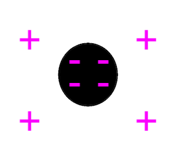
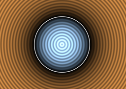
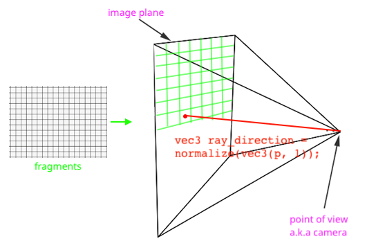
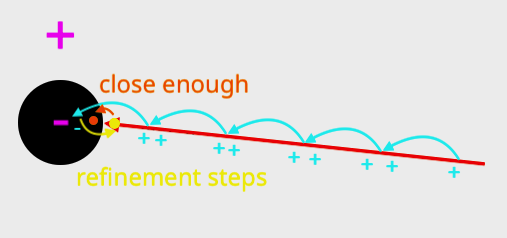
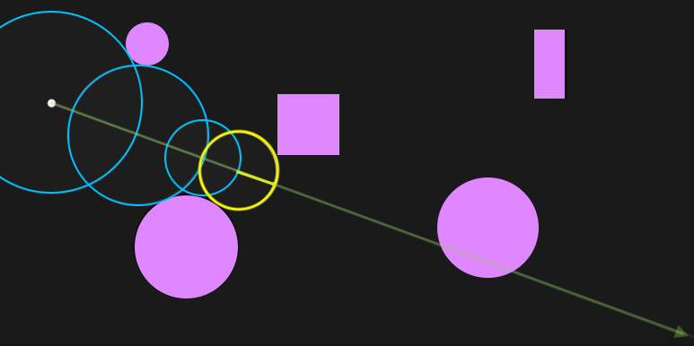
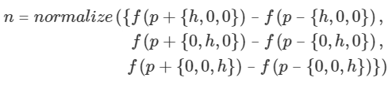
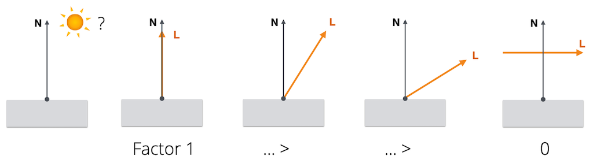
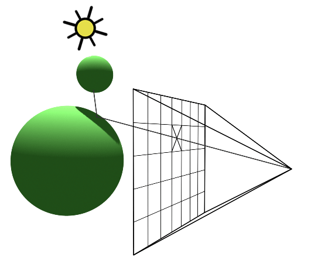

# Building a Sphere Tracer Step by Step

In this tutorial, we build a complete sphere tracer from scratch, from the distance function of a single sphere to a shaded scene with shadows. We start with an (almost) empty fragment shader and add one concept at a time. After every step, you should have a working shader.

The steps follow the slides on [geometry](../../../01_slides/shader_04_geometry_slides.html), [3D scene rendering](../../../01_slides/shader_05_rendering_slides.html) and [simple shading](../../../01_slides/shader_06_shading_slides.html).

For each step there is a code file with the result of that step. If you get lost, compare your code with it or simply continue from there.

| Step                   | Result                                                                                   |
| ---------------------- | ---------------------------------------------------------------------------------------- |
| Start                  | [spheretracing_step_00_start.frag](./spheretracing_step_00_start.frag)                   |
| 1. The SDF of a Sphere | [spheretracing_step_01_sdf_sphere.frag](./solution/spheretracing_step_01_sdf_sphere.frag)         |
| 2. Ray Marching        | [spheretracing_step_02_ray_marching.frag](./solution/spheretracing_step_02_ray_marching.frag)     |
| 3. Sphere Tracing      | [spheretracing_step_03_sphere_tracing.frag](./solution/spheretracing_step_03_sphere_tracing.frag) |
| 4. Normals             | [spheretracing_step_04_normals.frag](./solution/spheretracing_step_04_normals.frag)               |
| 5. Diffuse Shading     | [spheretracing_step_05_shading.frag](./solution/spheretracing_step_05_shading.frag)               |
| 6. Shadows             | [spheretracing_step_06_shadows.frag](./solution/spheretracing_step_06_shadows.frag)               |


* [The Start File](#the-start-file)
* [1. The SDF of a Sphere](#1-the-sdf-of-a-sphere)
    * [From a Slice to a 3D Image](#from-a-slice-to-a-3d-image)
* [2. Ray Marching](#2-ray-marching)
    * [The Camera](#the-camera)
    * [Marching Along the Ray](#marching-along-the-ray)
* [3. Sphere Tracing](#3-sphere-tracing)
    * [The Scene](#the-scene)
    * [Smarter Steps](#smarter-steps)
* [4. Normals](#4-normals)
* [5. Diffuse Shading](#5-diffuse-shading)
    * [Ambient Light](#ambient-light)
* [6. Shadows](#6-shadows)
    * [Moving the Light](#moving-the-light)
* [Summary](#summary)
* [References](#references)


## The Start File

The start file only contains what we already know, namely the fragment coordinates `p`, normalized so that `0,0` is in the middle of the screen, and the fragment `color` that is written into `gl_FragColor`.

For being able to follow this tutorial one concept step by step, the start file also contains markers like `// ---- [B] Signed Distance Functions ----`. They show you *where* new code goes.

| Marker                          | What goes there                                      |
| ------------------------------- | ---------------------------------------------------- |
| `[A]` Uniforms & Defines        | Constants (`#define`) and uniforms                   |
| `[B]` Signed Distance Functions | The SDFs of single shapes                            |
| `[C]` The Scene                 | The function that combines all shapes into one scene |
| `[D]` Moving Along the Ray      | The ray marching / sphere tracing function           |
| `[E]` Normals                   | The normal computation                               |
| `[F]` Shading                   | The shading computation                              |
| `[G]` The Camera                | *In `main()`:* camera position and ray direction     |
| `[H]` Tracing the Ray           | *In `main()`:* calling the tracing function          |
| `[I]` The Fragment Color        | *In `main()`:* computing the final `color`           |

Add new code directly below the marker, after any code that is already there (unless the text says otherwise). **The order of the markers matters!** In GLSL, a function must be defined *before* it is used, and the functions further down use the ones above them.

When we proceed from one step with the next, I recommend to comment out the old code instead of deleting it. That way you can always switch back and compare.


## 1. The SDF of a Sphere

> Instead of placing vertices, we describe shapes with functions.

This is ***implicit geometry***. It fits the fragment shader nicely as a fragment shader runs once per fragment and only knows its own coordinate. It can't draw anywhere else. All it can do is answer the question "What color am I?" So the following description of a shape has to answer: *Is this point inside the shape, on its edge, or outside?*, which then defines the color of that fragment.

For a circle, all points `(x, y)` with radius `r` around the origin fulfill the equation

```
0 = x² + y² - r²
```

We can rewrite this so that it gives us a *distance*:

```
d(x, y) = sqrt(x² + y²) - r
```

which, in GLSL, is the same as:

```glsl
float circle(vec2 p, float r) {
    return length(p) - r;
}
```

With `|d|` as the distance to the edge of the circle:

* `d < 0` → the point is inside,
* `d = 0` → the point is on the circle,
* `d > 0` → the point is outside.



This is the ***Signed Distance Function* (SDF)** of a circle. *Distance*, because it tells us how far a point is away from the edge, and *signed*, because the sign tells us on which side of the edge the point lies.

You can think of an SDF as describing many surfaces that are laid out as layers around the shape. Every layer has a constant distance value. The layer with the value `0` is the actual surface, the collection of points that lie exactly on it. It's called the *isosurface*.



For a sphere, we can easily add a third dimension. All points `(x, y, z)` on a sphere with radius `r` around the origin fulfill

```
0 = x² + y² + z² - r²
```

and the signed distance becomes

```
d(x, y, z) = sqrt(x² + y² + z²) - r
```

In GLSL, this is again `length(p) - r`, only now `p` is a `vec3`. Important: this assumes that the center of the sphere is at the origin.

**▶ TODO 1.1** at `[B]` -> Add the SDF of a sphere:

```glsl
// Signed distance function between
// point and sphere
float sdfSphere(vec3 p, float radius) {
    return length(p) - radius;
}
```

* Later, we will also use this function to ask for the distance of a point that lies on a ray to sphere as this is exactly what the absolute of the return value gives us.
* `length()` computes the Euclidean distance from the origin, `sqrt(x*x + y*y + z*z)`.

Now we need to call the function in `main()`. But which point do we ask for? We don't have a camera yet, so we can't look *at* the sphere yet. But we can look *into* its distance field: we take a slice through 3D space at `z = 0` and use the fragment coordinates `p` for `x` and `y`.

**▶ TODO 1.2** at `[I]` -> Call the SDF of the sphere for the current fragment:

```glsl
    // Visualization: a slice through the
    // distance field of the sphere at z = 0
    float distance_to_sphere = sdfSphere(vec3(p, 0.), 0.5);
```

* `p` in `main()` is the 2D fragment coordinate (`vec2`), but `sdfSphere()` expects a 3D point (`vec3`). `vec3(p, 0.)` builds that point from `p.x`, `p.y` and `z = 0.`.
* Note that `p` in `main()` and `p` in `sdfSphere()` are two different variables. When we call the function, the value `vec3(p, 0.)` is copied into the function's parameter `p`.
* `0.5` is the radius of the sphere.
* `distance_to_sphere` now holds the signed distance from the current fragment's point to the surface of the sphere.

**▶ TODO 1.3** at `[I]` -> Directly below, use the distance as the fragment color:

```glsl
    color = vec3(distance_to_sphere);
```

You see a black disc with a soft glow around it that gets brighter towards the corners. Inside the sphere the distances are negative, which is displayed as black. Outside, the distance grows the further away we are from the surface. The edge of the black disc is where the slice cuts the isosurface (`d = 0`).

**Try:** Replace the color line with `color = distance_to_sphere < 0. ? vec3(0.) : vec3(1.);`. Just like the circle in the geometry session, we now only use the sign with black inside, white outside.

**Try:** Change the `0.` in `vec3(p, 0.)` to `0.3` or `0.45`. The slice now cuts the sphere further away from its center, so the disc gets smaller. At `0.5`, the slice only touches the sphere in a single point, and beyond that it misses the sphere completely: the sphere has a radius of `0.5` around the origin, so it only reaches from `z = -0.5` to `z = 0.5`.

### From a Slice to a 3D Image

What we see is still flat. We pick one 2D slice out of the 3D distance field and color it, just as we did with the circle. Nothing tells us *how the sphere looks* from a certain point of view. For a real 3D image, two things are missing.

**1. A rendering algorithm.** We need a point of view, a camera, and for every fragment we need to find out *which surface is visible* through it. The classical algorithms don't work for us:

* *Rasterization* projects triangles onto the screen, and *classical ray tracing* computes the intersection of a ray with, e.g., triangles algebraically. Both need explicit geometry such as a triangulated mesh.
* We work in an "empty" fragment shader. We have no triangles and, strictly speaking, not even a "surface" to intersect with. We only have a function that we can ask for the distance to the surface at any point in space.

So we need an algorithm that finds the visible surface by only asking the SDF. This is *ray marching*, or better, *sphere tracing* (steps 2 and 3).

**2. Shading.** Knowing *that* a ray hits the sphere is not enough. If every hit gets the same color, a sphere looks like a flat disc. We perceive the 3D shape through how the surface reflects the light, normally brighter where it faces the light, darker where it turns away, and the shadow it casts. For that, we need the orientation of the surface at every point, the *normal*, and a light (steps 4 to 6).


## 2. Ray Marching

To determine the color of each fragment, we

1. shoot a ray through each fragment into the scene, and
2. detect the surface the ray hits and use the surface color for the fragment.

### The Camera

The camera is a point (`ray_origin`) that looks along the positive z-axis. We imagine the image plane at a distance of 1 in front of the camera. The current fragment lies at `p` on that plane, so the direction from the camera through the fragment is `vec3(p, 1)`.



**▶ TODO 2.1** at `[G]` -> Add the camera:

```glsl
    // The Camera
    // Camera position
    vec3 ray_origin = vec3(0, 0.1, -2);

    // Camera direction
    // Shooting a ray "through" the current fragment
    vec3 ray_direction = normalize(vec3(p, 1));
```

* The camera sits 2 units in front of the sphere (`z = -2`) and a tiny bit above its center (`y = 0.1`).
* We `normalize()` the direction so that it has length 1. Then `ray_direction * t` is a point exactly `t` units away from the camera along the ray.

### Marching Along the Ray

Strictly speaking, we don't have a "surface" that we could intersect a ray with. We only have a function that tells us the distance to the surface. So we go along the ray step by step and at every step, we ask the SDF how far the surface is away. Once we are close enough, we have a hit. This is called ***ray marching***.



**▶ TODO 2.2** at `[A]` -> Add the constants for the ray marching:

```glsl
// For the ray marching
#define STEPS_MAX 1000
#define DISTANCE_MAX 5.
#define DISTANCE_MIN .01
#define STEP_SIZE 0.01
```

* `STEPS_MAX`: how many steps we take at most. In WebGL, a loop needs a fixed maximum number of steps.
* `DISTANCE_MAX`: if we have moved further than this, we stop: the ray didn't hit anything.
* `DISTANCE_MIN`: if the surface is closer than this, we count it as a hit.
* `STEP_SIZE`: how far we move with every step.

**▶ TODO 2.3** at `[D]` -> Add the ray marching function:

```glsl
float rayMarching(vec3 ray_origin, vec3 ray_direction) {
    // How far we have moved along the ray so far
    float distance_traveled = 0.;

    for(int i=0; i < STEPS_MAX; i++) {
        // The current point on the ray
        vec3 point_on_ray = ray_origin + ray_direction * distance_traveled;

        // Compute the distance from the
        // current point to the surface
        // (for now our scene is only the sphere)
        float distance_to_scene = sdfSphere(point_on_ray, 0.5);

        // Are we close enough to the surface (or already inside)?
        // Then we have a hit with the scene.
        if(distance_to_scene < DISTANCE_MIN) break;

        // Move along the ray by a fixed step
        distance_traveled += STEP_SIZE;

        // Did we overshoot?
        if(distance_traveled > DISTANCE_MAX) break;
    }

    return distance_traveled;
}
```

* The function returns how far we have traveled along the ray.
* If we have a hit, this value is the distance from the camera to the surface (smaller than `DISTANCE_MAX`).
* If we don't have a hit, the value is larger than `DISTANCE_MAX`.

**▶ TODO 2.4** at `[H]` -> Call the function:

```glsl
    float distance_to_scene = rayMarching(ray_origin, ray_direction);
```

**▶ TODO 2.5** at `[I]` -> Comment out the slice visualization from step 1 and color every fragment whose ray hits something:

```glsl
    // Visualization: a slice through the
    // distance field of the sphere at z = 0
    // float distance_to_sphere = sdfSphere(vec3(p, 0.), 0.5);
    // color = vec3(distance_to_sphere);

    // Visualization: flat shading
    // Every fragment whose ray hits
    // the scene gets the same color
    if(distance_to_scene < DISTANCE_MAX) {
        color = vec3(1, 0, 1);
    }
```

Now you should see a magenta disc, which is our sphere, rendered in 3D! It looks flat however, because every hit gets the same color. We will fix this in step 5.

**Try:** Set `STEP_SIZE` to `1.2`. The sphere looks much smaller: rays near its edge only pass through the sphere for a short stretch, and with such a big step they jump right over it. A small step size fixes this, but then we need many steps for every single fragment. With a `STEP_SIZE` of `.01`, a ray that misses the sphere needs about 500 steps to reach the `DISTANCE_MAX` of only 5 units.

How could we improve performance? 🤔


## 3. Sphere Tracing

Sphere tracing implements smarter step sizes:

> The next step size is the smallest distance to all surfaces.



> This algorithm is called *sphere tracing* because when you compute the smallest distance from a point to all surfaces, this distance can be seen as the radius of a sphere within which we can move freely without ever intersecting with a surface. [[1]](#references)

Far away from all surfaces, we take big steps. Close to a surface, the steps get smaller and smaller. We stop once the next step size is below a threshold (`DISTANCE_MIN`).

### The Scene

How do we get the smallest distance to all surfaces? We iterate over all surfaces, compute the distance to each surface and keep the smallest one with `min()`.

Let's add a second shape, a floor. For a plane that is parallel to one of the axes of the coordinate system, we can simply use the coordinate of the point on that axis as the distance. For a horizontal plane (along x and z), this is

```
d(P, Plane) = P.y
```

This plane goes through the origin, right through our sphere. We want it below the sphere, at `y = -0.5`, so we use `P.y + 0.5`. Don't worry about this translation just yet, we will cover it in detail later.

**▶ TODO 3.1** at `[C]` -> Add the function that computes the minimal distance to all surfaces in the scene:

```glsl
// This function computes the
// minimal distance to all
// surfaces in the scene.
float sdfScene(vec3 p) {
    // We need to compute the distance to all surfaces
    // in the scene and keep the smallest distance
    float distance_to_scene = 1e20;

    // In this specific scene, we only have
    // one sphere and a plane

    // Spheres (at the origin)
    distance_to_scene = min(distance_to_scene, sdfSphere(p, 0.5));

    // Plane
    // (moved down by 0.5 - don't worry
    // about this translation just yet, we
    // will cover it in detail later)
    distance_to_scene = min(distance_to_scene, p.y + 0.5); // Axis aligned

    return distance_to_scene;
}
```

* We start with a huge distance (`1e20` = 10<sup>20</sup>), so that the first `min()` always takes the distance of the first shape.
* Every additional shape in the scene is one more `min()` line.

### Smarter Steps

**▶ TODO 3.2** at `[A]` -> Replace the ray marching constants. We don't need `STEP_SIZE` anymore, and we can now afford to look much further with far fewer steps:

```glsl
// For the sphere tracing
#define STEPS_MAX 100
#define DISTANCE_MAX 100.
#define DISTANCE_MIN .01
```

**▶ TODO 3.3** at `[D]` -> Replace the function `rayMarching()` with the function `sphereTracing()`:

```glsl
float sphereTracing(vec3 ray_origin, vec3 ray_direction) {
    // How far we have moved along the ray so far
    float distance_traveled = 0.;

    for(int i=0; i < STEPS_MAX; i++) {
        // The current point on the ray
        vec3 point_on_ray = ray_origin + ray_direction * distance_traveled;

        // Compute the minimal distance from the
        // current point to all surfaces in the scene
        // (the radius of the sphere in which we
        // can move freely)
        float distance_to_scene = sdfScene(point_on_ray);

        // Is the step size below the threshold?
        // Then we have a hit with the scene.
        if(distance_to_scene < DISTANCE_MIN) break;

        // Move along the ray by that distance
        distance_traveled += distance_to_scene;

        // Did we overshoot?
        if(distance_traveled > DISTANCE_MAX) break;
    }

    return distance_traveled;
}
```

Compared to `rayMarching()`, only two lines changed:

* `sdfSphere(point_on_ray, 0.5)` -> `sdfScene(point_on_ray)`: we ask for the distance to *all* surfaces.
* `distance_traveled += STEP_SIZE;` -> `distance_traveled += distance_to_scene;`: the step size is now the distance to the closest surface.

**▶ TODO 3.4** at `[H]` -> Call the new function:

```glsl
    float distance_to_scene = sphereTracing(ray_origin, ray_direction);
```

**▶ TODO 3.5** at `[I]` -> Comment out the flat shading and visualize the distance instead (add it *above* the flat shading):

```glsl
    // Visualization: distance value
    // We need to make the value smaller
    // for using it as fragment color
    distance_to_scene /= 10.;
    // Visualisation of the distance field
    color = vec3(distance_to_scene);

    // Visualization: flat shading
    // Every fragment whose ray hits
    // the scene gets the same color
    // if(distance_to_scene < DISTANCE_MAX) {
    //     color = vec3(1, 0, 1);
    // }
```

* Colors run from 0 to 1, but our distances are much larger. Dividing by 10 brings them into a visible range.

The closer a surface point is to the camera, the darker it is. The sphere is almost black, the floor gets brighter towards the horizon, and the sky (no hit, distance > 100) is white.

**Try:** Switch back to the flat shading (comment out the distance visualization, and remove the comments from the flat shading). Now the floor covers the lower half of the image, and the sphere and the floor merge into one magenta shape. We need shading to tell them apart.


## 4. Normals

For shading, we need to know how a surface point is oriented towards the light. Hence, we need the ***normal*** of the surface at that point. But we don't have a mesh with normals, we only have a function.

For an implicit surface, we can use the ***gradient*** of the SDF. The gradient is the direction of the fastest increase of a function. It can be proven that the gradient is always perpendicular to the iso-surfaces of the function, so the gradient at a point on the surface gives us the normal at that point:

```
n = normalize(∇f(p))
```

A favorite way to compute the gradient, due to its simplicity, is **central differencing**. For each axis, we take a tiny step `h` in the positive and in the negative direction, evaluate the SDF there and subtract the two values. This tells us how fast the distance changes along that axis. The three results together form the gradient vector:



Strictly, we would also have to divide by `2h`. We can skip this because we normalize the vector anyway.

**▶ TODO 4.1** at `[A]` -> Add a constant for `h`, below the sphere tracing constants:

```glsl
// For the normal computation
// (the h from the formula)
#define EPSILON 0.0001
```

**▶ TODO 4.2** at `[E]` -> Add the normal computation:

```glsl
// Computing the normal for
// point p in regard to the
// surface description of the
// scene.
vec3 estimateNormal(vec3 p) { // p is point_on_surface
    vec3 n = vec3(
        sdfScene(vec3(p.x + EPSILON, p.y, p.z)) - sdfScene(vec3(p.x - EPSILON, p.y, p.z)),
        sdfScene(vec3(p.x, p.y + EPSILON, p.z)) - sdfScene(vec3(p.x, p.y - EPSILON, p.z)),
        sdfScene(vec3(p.x, p.y, p.z  + EPSILON)) - sdfScene(vec3(p.x, p.y, p.z - EPSILON))
    );

    // The same as above but more
    // elegantly with swizzling
    // const vec2 h = vec2(EPSILON,0);
    // vec3 n = vec3(sdfScene(p+h.xyy) - sdfScene(p-h.xyy),
    //               sdfScene(p+h.yxy) - sdfScene(p-h.yxy),
    //               sdfScene(p+h.yyx) - sdfScene(p-h.yyx));

    return normalize(n);
}
```

* We use `sdfScene()` and not `sdfSphere()`, so this works for every surface in the scene.
* The swizzling version does the same: with `h = vec2(EPSILON, 0)`, `h.xyy` is `vec3(EPSILON, 0, 0)`, `h.yxy` is `vec3(0, EPSILON, 0)` and so on.

To compute a normal, we need the point on the surface that the ray hit. We get it by going from the camera along the ray direction by the distance that the sphere tracing returned. If the ray didn't hit anything, there is no surface point. In that case, we set a background color and stop right away with `return`.

**▶ TODO 4.3** at `[I]` -> Comment out the distance visualization and add the following *below* the (commented) flat shading:

```glsl
    // If we didn't hit anything,
    // set background color and stop.
    if(distance_to_scene > DISTANCE_MAX) {
        gl_FragColor = vec4(0.65, 0.75, 0.9, 1.0);
        return;
    }
    // Get the point on the surface that
    // we want to compute the shading for.
    // This is the closest point on the surface
    // from the origin looking along the view ray.
    vec3 point_on_surface = ray_origin + ray_direction * distance_to_scene;

    // Visualization: normals
    color = estimateNormal(point_on_surface);
```

* Important: the distance visualization must be commented out, because `distance_to_scene /= 10.;` changes the value that we need now.
* We display the normal's x, y, z as red, green, blue.

The floor is green: its normal points straight up, `(0, 1, 0)`. The sphere is red on the right (normals pointing towards +x), green at the top and yellow in between. Where the normals point left, down or towards the camera (negative x, y or z), the sphere is black, because negative values are displayed as black.

**Try:** `color = estimateNormal(point_on_surface) * 0.5 + 0.5;` maps the values from -1..1 to 0..1, so that you can also see the normals that point left, down and towards the camera.


## 5. Diffuse Shading

Now we have the normals and can compute how a surface point is oriented towards the light. We need to know how the surface point reflects the incoming light to know which light reaches the eye.

As reflection behavior we use ***diffuse shading***, also called *Lambert* shading. A diffuse reflection looks the same under all observation directions. **It only depends on the light direction.**

As the angle between the normal and the light direction increases, the same beam of light is spread over a larger area, and the intensity of the light per unit surface area *decreases*. We want to multiply the light intensity with a factor that depends on this angle:



Cosine to the rescue! This is ***Lambert's Cosine Law***: we decrease the intensity of the light by a factor of `cos θ`, and `cos θ` is given by the **dot product** between the normal `N` and the direction to the light `L`:

```
cos θ = L · N
```

* Don't forget to normalize `L` and `N`! The dot product only equals `cos θ` for vectors of length 1.
* When the surface faces away from the light, the dot product becomes negative. The surface should not be illuminated at all, so we clamp the factor to zero: `max(L · N, 0)`.

For simplicity, we assume that the light has an intensity of `(1, 1, 1)`, so the light itself doesn't appear in the formula.

**▶ TODO 5.1** at `[F]` -> Add the shading function:

```glsl
vec3 getDiffuseShading(vec3 point_on_surface) {
    // The Light
    // Light position
    vec3 light_position = vec3(2, 8, 0);

    // Light direction
    vec3 direction_to_light = normalize(light_position - point_on_surface);

    // Normal of the surface
    vec3 surface_normal = estimateNormal(point_on_surface);

    // The reflection behavior
    vec3 color_material = vec3(0.8, 0.8, 0.8);
    float reflection_diffuse = max(dot(surface_normal, direction_to_light), 0.);


    return (color_material * reflection_diffuse);
}
```

* The light is a point light, high above the scene and a bit to the right.
* `light_position - point_on_surface` is the vector *from* the surface point *to* the light. That's the `L` from the formula.
* `color_material` is the color of the surface: a light grey.

**▶ TODO 5.2** at `[I]` -> Comment out the normal visualization and compute the shading instead:

```glsl
    // Visualization: normals
    // color = estimateNormal(point_on_surface);

    // Compute the lambert shading
    color = getDiffuseShading(point_on_surface);
```

Now the sphere looks round! It's brightest at the top, where it faces the light most directly, and it gets darker towards the bottom.

**Try:** Move the light by changing `light_position`.

### Ambient Light

Everything that faces away from the light is completely black. In reality, light bounces around and also reaches those areas a bit. For simple shading, we usually add a constant color to mimic this ***ambient light***.

**▶ TODO 5.3** at `[F]` -> In `getDiffuseShading()`, add the ambient color and add it to the result:

```glsl
    ...
    float reflection_diffuse = max(dot(surface_normal, direction_to_light), 0.);

    // Ambient Light
    // To lighten up everything a bit
    vec3 color_ambient = vec3(0.06, 0.1, 0.2);


    // return (color_material * reflection_diffuse);
    return vec3((color_material * reflection_diffuse) + color_ambient);
}
```

The dark side of the sphere is now a dark blue instead of black.


## 6. Shadows

Our sphere doesn't cast a shadow on the floor yet. How do we find out whether a point is in the shadow? We check if there is an object between the point we are shading and the light. If there is, the point is in the shadow!



And we already have a function that finds the next object along a ray: `sphereTracing()`. We just use it again, this time starting at the surface point and going towards the light.

1. Compute the distance from the point to the light.
2. Compute the distance from the point to the scene surfaces along the point-light ray.

> If the distance to the scene is smaller than the distance to the light then there is an object between surface point and light, and we need to add shadow to the shading of the point.

There is one catch: the surface point lies *on* the surface. Its distance to the scene is already smaller than `DISTANCE_MIN`, so the sphere tracing would stop immediately with a hit. Every point would be in shadow. That's why we move the point a tiny bit away from the surface, along the normal, before we start.

**▶ TODO 6.1** at `[A]` -> Add a constant for how far we move the point, below the sphere tracing constants:

```glsl
// For the shadow
#define MOVE_POINT .02
```

`MOVE_POINT` must be larger than `DISTANCE_MIN`.

**▶ TODO 6.2** at `[F]` -> In `getDiffuseShading()`, add the shadow computation after the ambient light, and multiply the diffuse part with the shadow factor in the `return`:

```glsl
    ...
    vec3 color_ambient = vec3(0.06, 0.1, 0.2);

    // The shadow
    // We need to make sure that we are not stuck inside of the shape
    // For that we move the point a tiny bit along the direction
    // of the surface normal (MOVE_POINT must be larger than
    // DISTANCE_MIN, otherwise we immediately hit the surface again)
    vec3 point_moved_up = vec3 (point_on_surface + surface_normal * MOVE_POINT);

    float distance_to_scene_light_direction =
                        sphereTracing(point_moved_up, direction_to_light);

    // If the distance to the scene is smaller than the distance to the light
    // then there is an object between surface point and light, and
    // with that the surface point is in the shadow
    float shading_shadow = 1.;
    if(distance_to_scene_light_direction < length(light_position-point_on_surface)) {
        // This factor reduces the light
        shading_shadow *= .1;
    }


    // return (color_material * reflection_diffuse);
    // return vec3((color_material * reflection_diffuse) + color_ambient);
    return vec3((color_material * reflection_diffuse * shading_shadow) + color_ambient);
}
```

* `length(light_position - point_on_surface)` is the distance to the light.
* If the shadow ray doesn't hit anything, `sphereTracing()` returns a value larger than `DISTANCE_MAX`, which is far beyond the light, so the point is lit.
* In the shadow, we keep only 10% of the diffuse light (`* .1`). The ambient light is not affected by the shadow.

You now see the shadow of the sphere on the floor.

**Try:** Set `MOVE_POINT` to `0.`. Everything is dark, because every shadow ray immediately hits the surface it starts on.

### Moving the Light

Let's animate the light. glsl-canvas sends the time since the start in seconds as the uniform `u_time`.

**▶ TODO 6.3** at `[A]` -> Declare the uniform, at the top of the section:

```glsl
// For animating the light
uniform float u_time;
```

**▶ TODO 6.4** at `[F]` -> In `getDiffuseShading()`, move the light in a circle, directly below the light position:

```glsl
    vec3 light_position = vec3(2, 8, 0);
    light_position.xz += vec2(sin(u_time), cos(u_time)) * 6.;
```

* `vec2(sin(u_time), cos(u_time))` is a point that moves on a circle with radius 1 over time.
* `* 6.` makes the circle bigger, so that the light circles above the scene with a radius of 6.
* We only change `x` and `z`, so the light stays at the same height.

The light now circles above the scene, and the shadow of the sphere moves with it. 🎉

Compare your result with [spheretracing_step_06_shadows.frag](./solution/spheretracing_step_06_shadows.frag).


## Summary

* We start with the coordinates of the fragment that needs to get a color and normalize them.
* From a point of view ("camera"), we shoot a ray through the fragment into the scene.
* We go step by step along the view ray to find the surface it hits.
    * For taking a step along the ray, we compute the distances to all objects in the scene.
    * From those distances we take the smallest one as step size.
    * We decide on an intersection once the step size is below a threshold.
* At the hit point, we estimate the normal with the gradient of the SDF (central differences).
* With the normal and the direction to the light, we compute the diffuse shading (Lambert), plus a bit of ambient light.
* For the shadow, we trace a second ray from the hit point towards the light. If it hits something before it reaches the light, the point is in the shadow.


## References

[[1] Hart, John. 1995. Sphere Tracing: A Geometric Method for the Antialiased Ray Tracing of Implicit Surfaces. The Visual Computer 12.](https://doi.org/10.1007/s003710050084)

[[2] Inigo Quilez. Normals for an SDF.](https://iquilezles.org/articles/normalsSDF/)

[[3] Scratchapixel. Rendering Implicit Surfaces and Distance Fields: Sphere Tracing.](https://www.scratchapixel.com/lessons/advanced-rendering/rendering-distance-fields/basic-sphere-tracer.html)

[[4] Sebastian Lague. 2019. Coding Adventure: Ray Marching.](https://www.youtube.com/watch?v=Cp5WWtMoeKg)
